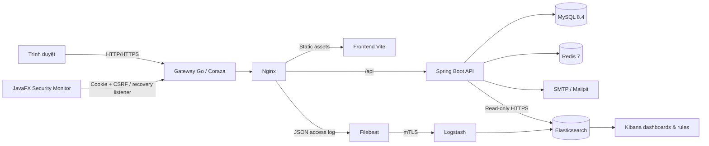

# Flare Fitness

Flare Fitness là hệ thống thương mại điện tử dành cho sản phẩm thể thao, được
xây dựng trong khuôn khổ PBL4. Repository không chỉ chứa ứng dụng bán hàng mà
còn tập trung vào bốn mục tiêu kỹ thuật:

1. Xây dựng đầy đủ luồng nghiệp vụ khách hàng, nhân viên và quản trị viên.
2. Bảo vệ ứng dụng từ trình duyệt, reverse proxy, API đến dữ liệu và secret.
3. Thu thập, phân tích và trực quan hóa Nginx access log bằng Elastic Stack.
4. Cung cấp ứng dụng desktop JavaFX để analyst xử lý incident theo mô hình
   Client–Server, với phân loại nhiễu cơ bản và lịch sử thao tác tập trung.

Ứng dụng có thể chạy độc lập bằng Docker Compose. Nginx phục vụ frontend Vite
đã build và reverse proxy `/api` đến Spring Boot; backend sử dụng MySQL cho dữ
liệu nghiệp vụ và Redis cho token, OTP, rate limit cùng trạng thái ngắn hạn.

## Trạng thái bản local — 25/10/2026

Source trên nhánh R2 đang được nâng nền ngày 26/10: Java 21, Spring Boot 4.1.2,
Connector/J 26.10.0 và Jackson 2 compatibility để giữ API hiện tại. Đây là
candidate đang kiểm chứng CI; các phiên bản này chưa thay thế stack local đã
nghiệm thu bên dưới. CI có tùy chọn `cold_cache` khi chạy thủ công, worker dùng
test image riêng và JavaFX được kiểm thử dưới Xvfb trước khi mở executable đã
đóng gói ở 1366×768 và 1920×1080. Dependency audit và coverage vẫn là gate bắt buộc.
Chính sách [bảo trì dependency của candidate lab](security/dependency-maintenance.md)
quy định thời hạn triage/khắc phục theo rủi ro và ngoại lệ có ngày hết hạn.
Việc có chính sách chưa chứng minh mọi phiên bản hiện tại đáp ứng các hạn đó.

Workflow **CI** có tùy chọn chạy thủ công `runtime_validation`: kiểm tra restart,
chuyển backend baseline/candidate tuần tự trên database tổng hợp rồi quan sát
HTTP/container trong một giờ. Gate yêu cầu ít nhất 30 chu trình, không có OOM
hoặc restart ngoài dự kiến, dự phòng 3 GiB RAM và 30 GiB ổ đĩa. Receipt này
phân biệt rõ kiểm chứng ổn định ứng dụng với qualification model cố định.
Gate chỉ chạy sau khi các job kiểm thử và security scan đạt. Workflow
**Observability runtime** cũ giữ nguyên trạng thái bật/tắt trên GitHub.
Base image candidate dùng Nginx 1.30.6 Alpine slim và Python 3.12 trên Ubuntu 24.04 LTS;
dependency lock của worker, model và input contract được giữ nguyên. Các kiểm
tra tương thích worker vẫn bắt buộc trước khi chuyển bản vào lab.

Candidate ASVS ngày 26/10 bổ sung đăng nhập mật khẩu → OTP email cho web và
JavaFX. Bật bằng `APP_LOGIN_OTP_ENABLED=true` trên backend (compose chính chuyển
biến này vào container); profile `security/asvs/docker-compose.tls.yml` bắt buộc
bật trong project CI riêng. Mặc định tương thích của bản local vẫn là `false`;
chế độ đó không được tính là đã đạt yêu cầu nhiều yếu tố. Đây là OTP qua email,
không phải phương thức chống phishing.

Khi bật OTP, `POST /api/auth/login` trả `202` với `challenge_id`, `expires_in`,
`email_masked`, `channel`; chưa cấp cookie/JWT. `POST /api/auth/login/otp` nhận
`challenge_id` và `otp_code`, vẫn bắt buộc CSRF, rồi trả response đăng nhập cũ
và cookie khi hợp lệ. Challenge hết hạn sau 300 giây, gắn tài khoản/security
version và IP/User-Agent quan sát bởi server; mã chỉ dùng một lần, tối đa năm
lần sai trong 300 giây theo tài khoản, yêu cầu mã mới cách nhau 60 giây. Muốn
mã mới, quay lại bước mật khẩu; không lưu mật khẩu, mã hoặc challenge trên disk.
Tài khoản thiếu email phải được xử lý qua quy trình quản trị hiện có.

Cổng SOC/recovery `8089` chuyển tiếp cả bước mật khẩu và bước xác minh OTP.
Backend vẫn kiểm tra CSRF, mã OTP và quyền; kênh này giữ nguyên lỗi 401/403 từ
backend và không mở thêm luồng đăng ký hoặc khôi phục mật khẩu.

Khi xác thực thành công, server cấp token mới và thu hồi phiên đang được trình
duyệt/client gửi kèm. Bước mật khẩu đang chờ OTP hoặc OTP sai không thu hồi
phiên hiện tại. Các thiết bị khác giữ phiên riêng; `logout-all` vẫn thu hồi
toàn bộ. Việc xoay phiên bình thường không tạo bằng chứng replay sau một hành
động thu hồi có chủ đích của SOC. JSON đăng nhập và trạng thái 202/200 giữ nguyên.

Profile candidate HTTPS đặt `APP_SESSION_IDLE_SECONDS=900` và
`APP_JWT_EXPIRATION_SECONDS=28800`: phiên cần đăng nhập lại sau 15 phút không
có yêu cầu gắn tương tác gần đây, hoặc sau tối đa 8 giờ. Web chỉ gắn
`X-User-Activity: 1` khi có click/phím/scroll/touch thật trong 30 giây gần nhất;
JavaFX theo dõi tương tác ở cả cửa sổ chính và incident. Marker này chỉ làm mới
idle của phiên còn hiệu lực, không phải bằng chứng xác thực, không hồi sinh
phiên đã hết hạn/thu hồi và không tăng thời hạn tuyệt đối. Refresh nền tự nó
không gia hạn. Redis dùng thêm một key nhỏ cho mỗi phiên. Bật timeout yêu cầu
các phiên cũ đăng nhập lại; mặc định local `APP_SESSION_IDLE_SECONDS=0` giữ
chế độ tương thích và không được tính là đã đạt kiểm soát inactivity của ASVS.

OTP email cho đăng ký, khôi phục, đổi email và xác nhận thao tác được lưu bằng
hash có salt, dùng cùng encoder của ứng dụng. Redis chỉ nhận hash và kết quả
đối chiếu; Lua kiểm tra lại đúng phiên bản hash trước khi tiêu thụ mã để tránh
xác minh mã cũ làm mất mã vừa gửi lại. Thời hạn, cooldown và ngân sách thử vẫn
giữ nguyên. Khi chuyển binary mới, mã plaintext còn đang chờ sẽ không được
chấp nhận; người dùng yêu cầu mã mới sau cooldown. Không đổi tài khoản, mật
khẩu, cấu hình OTP/mail hoặc dữ liệu lịch sử để thực hiện nâng cấp này.

Token đặt lại mật khẩu là chuỗi opaque: client chỉ giữ tạm và gửi lại nguyên
chuỗi, không phân tích UUID. Token mới được tạo từ 32 byte `SecureRandom`, mã
hóa Base64url không padding (43 ký tự). Redis tiếp tục lưu fingerprint với TTL
và binding tài khoản hiện có; token UUID đã cấp có binding hợp lệ vẫn dùng được
một lần trong thời hạn còn lại. Không có migration hoặc reset credential.

Danh sách phiên Redis chỉ giữ hoặc kéo dài thời hạn khi thêm/chuyển token,
không rút ngắn theo token cũ sắp hết hạn. Danh sách legacy không hết hạn được
giữ nguyên; bản vá không khôi phục các thành viên đã mất trước đó.

Chính sách mật khẩu mới dùng chung cho đăng ký, đổi/khôi phục và quản trị tạo/
đổi mật khẩu: 12–128 ký tự Unicode, cho phép passphrase và giữ nguyên khoảng
trắng/chữ hoa thường. Không reset hay bắt đổi mật khẩu định kỳ. Riêng hash
BCrypt cũ không thể xác minh phần vượt 72 byte UTF-8 và có thể nhập nhằng byte
NUL ở biên: candidate từ chối đầu vào vượt giới hạn đó hoặc có NUL, yêu cầu
đặt lại qua luồng khôi phục hiện có. Mật khẩu dùng
hash mới vẫn hỗ trợ đủ 128 ký tự Unicode. Backend kiểm tra offline bằng 46.640
hash của mật khẩu phổ biến/đã xuất hiện trong corpus công khai, cùng danh sách
ngữ cảnh `flarefitness`, `flaresoc`, `pbl4`, `socdemo`, `socpractice`,
`securitymonitor` và biến thể phân cách/chữ hoa/leet cơ bản. Đây là tập hữu hạn,
không bảo đảm phát hiện mọi mật khẩu từng bị lộ. Dữ liệu nhị phân khoảng 1,42 MiB,
RAM tăng khoảng 1,5–2 MiB; không có truy vấn mạng theo mật khẩu người dùng.
Nguồn, digest và giấy phép được lưu trong `security/passwords/`.

Workflow CI có tùy chọn `asvs_validation`: kiểm tra API trên MySQL/Redis riêng,
trình duyệt qua HTTPS có CA tin cậy, DAST giới hạn và pipeline ELK. Chỉ có runner
GitHub được phép khởi tạo project này; báo cáo chi tiết được mã hóa bằng public
certificate, private key giữ ngoài repository. Thành công của scanner không
đồng nghĩa đạt toàn bộ 253 yêu cầu ASVS 5.0.0 L1/L2 hoặc qualification model.
TLS candidate chỉ cho phép TLS 1.2/1.3 với bộ mã AEAD, ưu tiên bộ mã phía server;
trang lỗi do TLS edge sinh cũng có CSP, chống nhúng và `nosniff`. CSP giao diện
dùng `base-uri 'none'`; HTML ứng dụng khai báo UTF-8. Nginx chủ động bỏ charset
trên redirect 301/302 gốc; kiểm tra này chưa chứng minh charset cho mọi phản hồi.
Chứng thư tạm của
CI có quyền CA/serverAuth rõ ràng và được kiểm tra chuỗi/hostname ở chế độ strict.
Cache CVE lạnh được khởi tạo qua feed chính thức của NIST, từ chối metadata cũ
quá 48 giờ; ngưỡng dependency audit CVSS 7 không thay đổi. Hướng dẫn feed:
[OWASP Dependency-Check](https://dependency-check.github.io/DependencyCheck/data/mirrornvd.html).

Bản SIEM/SOC R2 đã được triển khai và nghiệm thu chức năng trong lab:

- Một stack `flare-otp-local` phục vụ website, SOC và pipeline ELK, giữ nguyên
  database, tài khoản, OTP/mail và các ca demo hiện có.
- Website qua gateway tại `http://127.0.0.1:8088`; SOC/recovery API tại
  `http://127.0.0.1:8089`; Kibana tại `http://127.0.0.1:5601`.
- JavaFX có đúng năm mục: **Dashboard**, **Incident queue**, **Block IP**,
  **History**, **GeoIP & IP intelligence**. Login chỉ chứa logo và form.
- Hàng đợi hiển thị tên tình huống ngắn gọn, IP nguồn, người nhận theo
  tên–vai trò và thời gian sự kiện. Ca thực hành được ghi rõ nguồn fixture.
- Một cửa sổ incident được dùng lại, hỗ trợ phóng to/toàn màn hình bằng F11.
  Hai tab là **Thông tin log** và **Dòng thời gian log**; xử lý nằm dưới thông
  tin, lịch sử xử lý SOC chỉ xuất hiện khi ca đã đóng.
- Evidence ELK giữ nguyên cấu trúc Elasticsearch hit và `_source`; Fields/JSON,
  tìm kiếm, copy và export không trộn workflow/model vào log gốc. Thời gian log
  và metadata liên kết được xử lý riêng; thiếu bằng chứng được hiển thị rõ.
- Sáu nhóm điều tra auth/session gồm brute force đăng nhập, password spraying,
  chuỗi đăng nhập–thao tác nhạy cảm, phiên bất thường, lạm dụng OTP và tái sử dụng
  phiên đã thu hồi. L2/Admin có thao tác cô lập tài khoản khách theo incident.
- Chính sách tái phạm IP hỗ trợ 15 phút, 1 giờ, 24 giờ và đến khi gỡ; mức không
  hết hạn chỉ dùng bằng chứng signature ACTIVE đã kiểm thử và gateway ACK.
- Tra cứu reputation và tạo block chỉ nhận địa chỉ đủ điều kiện public theo
  snapshot IANA được rà soát ngày 28/10/2026: loại dải đặc biệt không global,
  N/A hoặc đã ngừng dùng, giữ ngoại lệ global cụ thể hơn dải cha. IPv6 chưa được
  IANA cấp cũng bị loại, trừ ngoại lệ special-purpose global được phép.
  Địa chỉ không hợp lệ bị trả 400 ở thao tác nhập tay hoặc bỏ qua khi tự chặn;
  bản ghi cũ được giữ và block cũ vẫn có thể gỡ theo ID. Đây là phân loại địa chỉ,
  không phải kiểm tra IP đang hoạt động; không có truy vấn DNS/registry lúc chạy.

Model baseline schema 6/65 feature giữ phạm vi `PROJECT_LIMITED`, allowlist,
OTP độc lập và hold tối đa 600 giây. Candidate schema 7/81 feature chỉ chạy
`PILOT_ONLY / SHADOW`, không tự tạo hold, chặn IP hoặc cô lập tài khoản.
Kết quả lab không chứng minh qualification production strict hay độ chính xác
trên toàn bộ người dùng. Rà soát security toàn repository đang được tiếp tục;
không coi bản này là đã hoàn tất security audit.

Kiểm chứng cho R2: 21 test backend liên quan qua; gói JavaFX chạy 172 test với
6 test tùy chọn được bỏ qua và không có lỗi; 3 test UI trực tiếp L1/L2 và
Fields/JSON chính xác đều qua. Đây là các kiểm tra đã chạy cho bản lab, không
phải kết quả của toàn bộ CI trên một checkout mới.

Repository chứa source, migration, contract và test. Database, model publication,
capture/training data, secret, backup, file đăng nhập và receipt vận hành local
không đưa lên Git. Checkout mới cần cấu hình và artifact riêng theo runbook;
không chạy lại seed hoặc restore đè database đang dùng.

Hướng dẫn: [JavaFX client](desktop-client/README.md),
[SOC L1/L2](docs/LOCAL_SOC_DEMO_L1_L2.md),
[workspace và auth pilot](docs/LOCAL_SOC_WORKSPACE_AUTH_PILOT.md),
[postlogin project](docs/LOCAL_POSTLOGIN_PROJECT.md).

## Mục lục

- [Dự án đang làm gì?](#dự-án-đang-làm-gì)
- [Trạng thái bản local](#trạng-thái-bản-local--25102026)
- [Chức năng chính](#chức-năng-chính)
- [Kiến trúc hệ thống](#kiến-trúc-hệ-thống)
- [Công nghệ sử dụng](#công-nghệ-sử-dụng)
- [Cấu trúc repository](#cấu-trúc-repository)
- [Chạy nhanh bằng Docker](#chạy-nhanh-bằng-docker)
- [Các chế độ chạy](#các-chế-độ-chạy)
- [Phát triển frontend](#phát-triển-frontend)
- [Kiểm thử](#kiểm-thử)
- [Observability và Elastic Stack](#observability-và-elastic-stack)
- [Bảo mật](#bảo-mật)
- [Database và Redis](#database-và-redis)
- [CI/CD](#cicd)
- [AWS lab](#aws-lab)
- [Tài liệu](#tài-liệu)
- [Giới hạn hiện tại](#giới-hạn-hiện-tại)

## Dự án đang làm gì?

Flare Fitness mô phỏng một hệ thống bán hàng thực tế thay vì chỉ trình diễn giao
diện. Một request từ trình duyệt phải đi qua Nginx, lớp xác thực/phân quyền của
Spring Security, service nghiệp vụ, MySQL hoặc Redis; access log sau đó có thể
được chuyển qua Filebeat và Logstash để phân tích trong Elasticsearch/Kibana.

Các phần đang được triển khai và kiểm chứng trong repository gồm:

- Website mua sắm sản phẩm thể thao cho khách hàng.
- API quản lý sản phẩm, tài khoản, đơn hàng, đánh giá, voucher và hỗ trợ.
- Xác thực JWT qua cookie, CSRF, OTP email và phân quyền theo vai trò.
- Flyway migration làm nguồn duy nhất cho cấu trúc database.
- Docker Compose cho local development, integration test và E2E.
- Nginx hardening, trusted proxy policy và security headers.
- Gateway Go + Coraza/OWASP CRS đứng trước Nginx để kiểm tra request web;
  mẫu chỉ chặn khi L2/Admin đã kiểm thử và kích hoạt.
- Pipeline Nginx → Filebeat → Logstash → Elasticsearch → Kibana.
- Flare Security Monitor (JavaFX) dùng API Spring Boot để xem log/GeoIP, nhận,
  phân loại và xử lý incident từ nhiều máy khách.
- GeoIP, dashboard, detection rule, disk queue và persistent queue.
- Terraform và cloud-init cho mô hình Web EC2 + Monitor EC2 trên AWS.
- CI kiểm tra test, coverage, dependency, container, IaC và supply chain.

## Chức năng chính

### Khách hàng

- Xem, tìm kiếm, lọc và sắp xếp sản phẩm.
- Đăng ký, đăng nhập, đăng xuất và đăng xuất khỏi mọi thiết bị.
- Xác minh OTP khi đăng ký hoặc đặt lại mật khẩu.
- Xem và cập nhật hồ sơ, email, mật khẩu.
- Tạo đơn hàng, xem lịch sử, gửi yêu cầu hủy hoặc đổi trả.
- Đánh giá sản phẩm đã mua.
- Nhận, áp dụng và theo dõi voucher.
- Tham gia chiến dịch promo hunt và nhận ưu đãi.
- Gửi/nhận tin nhắn hỗ trợ.
- Nhận gợi ý sản phẩm dựa trên dữ liệu hành vi được phép thu thập.

### Nhân viên và quản trị viên

- Quản lý danh mục sản phẩm và biến thể sản phẩm.
- Theo dõi và cập nhật trạng thái đơn hàng.
- Kiểm duyệt đánh giá sản phẩm.
- Quản lý voucher và việc gán voucher cho người dùng.
- Xử lý hội thoại hỗ trợ khách hàng.
- Xem dữ liệu analytics tổng hợp.
- Quản trị viên có thêm quyền quản lý tài khoản và chiến dịch promo hunt.

### Vận hành và giám sát

- Health check cho Nginx, backend, MySQL, Redis và Elastic Stack.
- Nginx ghi access log JSON có request/trace ID.
- Filebeat gửi log qua mTLS và có disk queue.
- Logstash parse, chuẩn hóa, redaction và GeoIP enrichment.
- Elasticsearch áp dụng data stream, mapping và retention policy.
- Kibana cung cấp ba dashboard và sáu detection rule trong local lab.
- Bài kiểm tra recovery xác nhận queue và dữ liệu tồn tại sau outage/restart.

## Kiến trúc hệ thống



Luồng chính:

1. Sơ đồ mô tả stack có gateway. Base Compose phục vụ trực tiếp qua Nginx;
   các overlay gateway bỏ cổng publish của Nginx. Backend dùng mạng nội bộ.
2. Frontend và API dùng cùng origin để cookie xác thực và CSRF hoạt động đúng.
3. Spring Boot kiểm tra xác thực/phân quyền trước khi gọi service và repository.
4. Flyway cập nhật schema trước khi ứng dụng nhận traffic.
5. Khi bật profile observability, access log được chuyển qua pipeline Elastic
   mà không cần publish Elasticsearch hoặc Logstash ra host.

## Công nghệ sử dụng

| Lớp | Công nghệ | Vai trò |
| --- | --- | --- |
| Frontend | Vite 6, HTML, CSS, JavaScript ES modules | Giao diện người dùng và admin |
| Desktop | JavaFX 21, FXML, CSS, Java HttpClient | Client SIEM cho security analyst |
| Edge | Nginx stable Alpine | Static hosting, reverse proxy, header và access log |
| Backend | Java 21, Spring Boot 4.1.2 | REST API và nghiệp vụ |
| Security | Spring Security, JWT, BCrypt-SHA256, CSRF | Xác thực và phân quyền |
| Database | MySQL 8.4, Spring Data JPA, Flyway | Dữ liệu nghiệp vụ và migration |
| Cache/state | Redis 7 | Token, OTP, rate limit và state ngắn hạn |
| Email | Spring Mail, SMTP, Mailpit | OTP thật hoặc email E2E cô lập |
| Test | JUnit, Testcontainers, Vitest, Playwright | Unit, integration, coverage và E2E |
| Observability | Filebeat, Logstash, Elasticsearch, Kibana 9.4 | Log pipeline, dashboard và alert |
| Infrastructure | Docker Compose, Terraform, cloud-init | Local runtime và AWS lab |
| CI/security | GitHub Actions, OWASP Dependency-Check, Trivy, SBOM | Quality gate và supply-chain checks |

Các image runtime và GitHub Action quan trọng được pin bằng immutable digest để
giảm rủi ro thay đổi ngoài ý muốn.

## Cấu trúc repository

```text
.
├── backend/                    Spring Boot API, test và Flyway migration
├── frontend/                   Vite frontend, Vitest và Playwright
├── desktop-client/             JavaFX SIEM client và Linux packaging script
├── nginx/                      Nginx image, proxy và security headers
├── observability/              Elastic Stack, PKI, dashboard, rule và runbook
├── terraform/                  AWS network, EC2, EBS và cloud-init templates
├── scripts/                    Regression và Compose hardening checks
├── docs/                       ERD, phân tích thuật toán và evidence
├── docker-compose.yml          Stack nền tảng
├── docker-compose.dev.yml      Development fixture profile
├── docker-compose.e2e.yml      E2E fixture và Mailpit
└── .github/workflows/          CI và full observability runtime workflow
```

`db-init/` chỉ còn là dữ liệu legacy/tham khảo. Base Compose không mount hoặc
chạy MySQL init script trong thư mục này; Flyway là nguồn schema duy nhất.

## Chạy nhanh bằng Docker

### Yêu cầu

- Git.
- Docker Engine hoặc Docker Desktop có Compose v2.
- Khoảng 4 GB RAM trống cho application stack cơ bản.
- Port `80` và `3307` đang trống, hoặc đổi `HTTP_HOST_PORT`/port development
  tương ứng.

### Khởi động development stack

```bash
git clone https://github.com/VoThanhQuan-Pentest/PBL4.git
cd PBL4
cp .env.example .env

# Chỉnh credential local và APP_MAIL_* nếu muốn thử luồng OTP qua SMTP.
docker compose -f docker-compose.yml -f docker-compose.dev.yml up -d --build
docker compose -f docker-compose.yml -f docker-compose.dev.yml ps
```

Khi các health check đã thành công:

- Website: `http://localhost`
- API health: `http://localhost/api/health`
- MySQL, chỉ bind loopback: `127.0.0.1:3307`

Dừng stack nhưng giữ database, Redis và log volume:

```bash
docker compose -f docker-compose.yml -f docker-compose.dev.yml down
```

Không thêm `--volumes` nếu muốn giữ dữ liệu development.

### Tài khoản demo development

`docker-compose.dev.yml` bật Spring profile `dev`. Repeatable Flyway fixture tạo:

Thông tin đăng nhập local được lưu trong `TAI_KHOAN_DANG_NHAP.local.md` trên máy vận hành; file này không đưa vào Git.

Các tài khoản này chỉ dành cho local development. Base Compose không bật fixture
và không tự tạo tài khoản, PII, đơn hàng hay sản phẩm demo.

## Các chế độ chạy

| Chế độ | Compose files/profile | Mục đích |
| --- | --- | --- |
| Base | `docker-compose.yml` | Production-like app stack, không có fixture |
| Development | Base + `docker-compose.dev.yml` | Dữ liệu và tài khoản demo repeatable |
| E2E | Base + `docker-compose.e2e.yml` | Mailpit, fixture cô lập và Playwright |
| Local ELK | Base + E2E + monitor + local overrides | Pipeline observability đầy đủ |
| AWS Web | Base + `observability/docker-compose.web-aws.yml` | Web EC2, bind-mounted logs/Filebeat data |
| AWS Monitor | `observability/docker-compose.monitor.yml` | Elasticsearch, Logstash và Kibana |

Nên đặt Compose project name riêng khi chạy test song song để container, network
và volume không đụng nhau.

## Phát triển frontend

Yêu cầu Node.js 22.23.4 và backend đang chạy ở port `8080`, hoặc đặt
`VITE_API_PROXY_TARGET` đến backend phù hợp.

```bash
cd frontend
npm ci
npm run dev
```

Vite proxy `/api` đến backend, vì vậy frontend vẫn kiểm thử cookie và CSRF trong
cùng origin. Production bundle được build trong `nginx/Dockerfile` bằng lockfile.

Các lệnh hữu ích:

```bash
npm run test
npm run test:coverage
npm run build
npm run assets:verify
```

`assets:optimize` chuyển JPG/JPEG/PNG sang WebP và giới hạn mỗi file 500 KB;
`assets:migrate` cập nhật các tham chiếu frontend và seed SQL liên quan.

## Kiểm thử

### Backend unit và integration test

Backend integration test dùng Testcontainers với MySQL và Redis thật. Docker
daemon phải hoạt động; không bỏ integration test chỉ để có kết quả xanh.

```bash
cd backend
mvn -B -ntp verify
```

Lệnh `verify` chạy test, tạo JaCoCo report và áp dụng coverage gate đã khai báo
trong `backend/pom.xml`.

### Frontend unit, coverage và build

```bash
cd frontend
npm ci
npm run test
npm run test:coverage
npm run build
npm audit --audit-level=high
npm audit --omit=dev --audit-level=high
```

Không chạy `npm audit fix` tự động vì dependency upgrade cần được review và kiểm
thử riêng.

### Playwright E2E

```bash
docker compose -p flare-e2e --env-file .env.e2e.example \
  -f docker-compose.yml -f docker-compose.e2e.yml up -d --build

cd frontend
npm ci
npx playwright install --with-deps chromium
E2E_BASE_URL=http://127.0.0.1:8088 npm run test:e2e

cd ..
docker compose -p flare-e2e --env-file .env.e2e.example \
  -f docker-compose.yml -f docker-compose.e2e.yml \
  down --volumes --remove-orphans
```

Mailpit được publish ở `127.0.0.1:8025` trong E2E stack. Video Playwright tắt
mặc định để không phụ thuộc FFmpeg; đặt `PLAYWRIGHT_VIDEO=1` khi môi trường đã có
browser/FFmpeg phù hợp.

### Nginx, Compose và runtime regressions

```bash
sh nginx/test-hardening.sh
sh scripts/verify-compose-hardening.sh
scripts/verify-docker-runtime-regressions.sh
scripts/verify-redis-volume-migration.sh
```

Hai regression script Docker tự tạo project name cô lập và chỉ dọn tài nguyên
do chính bài test đó tạo ra.

## Observability và Elastic Stack

Local ELK lab yêu cầu Docker Compose 2.35+, `bash`, `curl`, `jq`, `openssl`,
x86_64, Internet để tải pinned image/GeoIP database và khoảng 16 GB RAM.

```bash
observability/scripts/local-lab.sh bootstrap
observability/scripts/local-lab.sh validate
observability/scripts/local-lab.sh up
observability/scripts/local-lab.sh verify
observability/scripts/local-lab.sh evidence
```

Endpoint mặc định:

- Web: `http://127.0.0.1:8088`
- Kibana: `http://127.0.0.1:5601`

Nếu port đang được sử dụng, đặt `LOCAL_LAB_WEB_PORT` hoặc
`LOCAL_LAB_KIBANA_PORT`; không cần dừng dịch vụ khác trên máy.

Dừng và giữ dữ liệu/queue:

```bash
observability/scripts/local-lab.sh down
```

Xóa toàn bộ local lab chỉ khi chủ động xác nhận:

```bash
LOCAL_LAB_PURGE_CONFIRM=yes observability/scripts/local-lab.sh purge
```

Pipeline kiểm tra mapping, lifecycle, redaction, parse error, deduplication,
GeoIP, detection alert, analyst role, queue recovery, logrotate continuity và
khả năng giữ dữ liệu sau restart. Chi tiết vận hành nằm trong
[observability/README.md](observability/README.md).

### Ứng dụng SOC và UEBA (local)

Ứng dụng JavaFX sử dụng API Spring Boot, không kết nối trực tiếp MySQL hay
Elasticsearch. Backend ghi sự kiện bảo mật của khách hàng vào MySQL outbox;
Filebeat chuyển bản NDJSON qua Logstash để Elasticsearch lưu trữ và bổ sung
GeoIP cho IP công khai. Một job khác tổng hợp hành vi theo cửa sổ 15 phút.
Worker Python chạy Isolation Forest trên 11 đặc trưng số, sau khi Admin huấn
luyện và kích hoạt model ứng viên. Điểm số AI là độ bất thường tương đối,
**không phải xác suất tài khoản bị xâm nhập**; quy tắc minh bạch vẫn hoạt động
khi worker/model chưa sẵn sàng.

Incident mới vào hàng đợi SOC L1. L1 nhận việc, ghi chú và chuyển ca đáng ngờ
cho L2; L2 kết luận và, khi có căn cứ, chủ động thu hồi các phiên khách hàng.
Hệ thống không tự khóa tài khoản. JavaFX có biểu đồ tròn về mức độ, trạng
thái, phân loại, hàng đợi SOC và nguồn phát hiện, cùng watchlist tài khoản.
Các tài khoản và event giả lập được gắn nhãn riêng; model huấn luyện hoàn toàn
từ dữ liệu demo hiện rõ `DEMO_ONLY`. Quy trình seed, huấn luyện, kiểm chứng
và lệnh chỉ chạy local nằm ở
[hướng dẫn UEBA](observability/README.md#local-uebasoc-demo). Không bước nào
trong quy trình này tự chạy AWS hoặc Terraform.

Lớp phòng vệ local bổ sung kiểm tra toàn bộ HTTP trước Nginx, quản lý mẫu SQLi,
XSS, traversal và đường dẫn qua vòng đời nháp/kiểm thử/L2 duyệt, ban IP có thời
hạn, cùng tra cứu nền IPinfo/AbuseIPDB. IP reputation chỉ bổ sung bằng chứng;
riêng cờ VPN/hosting hay một điểm bên ngoài không tự chặn người dùng. Môi
trường mới không có mẫu chặn được kích hoạt cho đến khi SOC duyệt một mẫu.

## Bảo mật

Các lớp bảo vệ chính của project:

- JWT được gửi bằng cookie `HttpOnly`, `SameSite=Strict`; production bắt buộc
  cookie `Secure`.
- CSRF dùng cookie/token riêng và được kiểm tra cho request thay đổi trạng thái.
- Mật khẩu được mã hóa bằng BCrypt-SHA256 cost 12.
- JWT/token state lưu trong Redis dưới dạng fingerprint phù hợp thay vì coi
  browser token là session server truyền thống.
- `ADMIN`, `STAFF`, `CUSTOMER`, `SOC L1`, `SOC L2` có quyền API tách biệt.
- CORS production chỉ chấp nhận origin HTTPS cụ thể, không wildcard với cookie.
- Nginx không tin `X-Forwarded-*` từ client; chỉ tin CIDR của TLS terminator ngay
  trước nó khi được cấu hình rõ.
- Backend chạy non-root, read-only filesystem và không có Linux capability.
- MySQL chỉ publish loopback trong development; Elasticsearch và Logstash không
  publish ra host trong local ELK.
- Filebeat → Logstash dùng mTLS; secret/keystore nằm ngoài Git.
- Access log không ghi body, cookie, Authorization, JWT hoặc CSRF token; query
  value được redaction trước khi ingest.
- Nginx native diagnostics đi qua bộ phân loại trước khi lưu vào
  `native-errors.json.log` và Docker stderr: chỉ giữ thời gian, mức độ và mã lỗi
  cố định, không giữ nội dung request/header/path thô. PID1 chuyển tiếp signal
  và mở lại log khi nhận USR1. Log cũ được giữ nguyên; quy tắc này không che dữ
  liệu tùy ý trong path/User-Agent của access log hoặc thay thế đánh giá ASVS.
- Production profile fail-fast khi phát hiện JWT, cookie, CORS, datasource,
  Redis, SMTP hoặc trusted-proxy configuration không an toàn.

Không commit `.env`, private key, password, keystore, Terraform state hoặc nội
dung `.secrets/`. `.env.example` chỉ là template development và chứa placeholder
cố ý bị production validator từ chối.

## OTP SMTP

Để thử đăng ký, đổi email hoặc đặt lại mật khẩu qua OTP, cấu hình trong `.env`:

```dotenv
APP_MAIL_USERNAME=your-smtp-user
APP_MAIL_FROM=your-sender-address
APP_MAIL_PASSWORD=your-app-password
```

Với Gmail, dùng App Password thay vì mật khẩu đăng nhập thường. Không commit App
Password. Khi SMTP chưa hợp lệ, API trả lỗi cấu hình và không âm thầm tạo tài
khoản hoặc hoàn tất đặt lại mật khẩu khi email chưa được gửi.

## Database và Redis

### Flyway

- Flyway là nguồn duy nhất quản lý schema.
- Môi trường mới không import `schema_full.sql` hoặc chạy `db-init/`.
- Database hiện có phải được backup và thử restore trước khi nâng cấp.
- Migration versioned nằm trong `backend/src/main/resources/db/migration/`.

Sau migration V7, kiểm tra record chưa xử lý trong
`tbl_kiem_toan_lien_ket_khach_hang` với `resolved_at IS NULL`. Chỉ liên kết thủ
công khi email hoặc số điện thoại đã được xác minh; không dựa vào họ tên.

Migration V9 đưa credential legacy không phải BCrypt vào
`tbl_tai_khoan_can_dat_lai_mat_khau` và thay giá trị cũ bằng marker ngẫu nhiên.
Người dùng cần đặt lại mật khẩu qua OTP; tài khoản chưa có email xác minh phải
được xử lý bằng quy trình xác minh thủ công.

### Redis persistence và migration

Redis dùng named volume `redis-data`. Mất Redis không làm mất đơn hàng trong
MySQL nhưng có thể làm mất JWT session, OTP và rate-limit state đang hoạt động.

Host cũ còn dùng anonymous/legacy volume phải thực hiện maintenance migration:

```bash
cd /opt/flare
COMPOSE_PROJECT_NAME=flare observability/scripts/migrate-redis-volume.sh check
COMPOSE_PROJECT_NAME=flare REDIS_VOLUME_MIGRATION_CONFIRM=yes \
  observability/scripts/migrate-redis-volume.sh prepare
COMPOSE_PROJECT_NAME=flare observability/scripts/migrate-redis-volume.sh verify
```

Migration dừng luồng ghi, chạy Redis `SAVE`, copy RDB sang target và rollback
volume, so sánh checksum, kiểm tra marker có TTL rồi mới cut over. Source và
rollback volume không bị xóa tự động.

## CI/CD

Workflow [`.github/workflows/ci.yml`](.github/workflows/ci.yml) chạy:

- Frontend test, coverage, production build và npm audit.
- Backend full test/Testcontainers, Flyway integration và JaCoCo gate.
- OWASP Maven Dependency-Check.
- Dependency Review cho pull request.
- Nginx, security header và Compose hardening.
- Logrotate permission và Redis migration regressions.
- Observability config validation và ShellCheck.
- Terraform fmt/validate và IaC misconfiguration scan.
- Playwright desktop/mobile E2E.
- Trivy filesystem/container scan và CycloneDX SBOM.

Workflow [`.github/workflows/observability-runtime.yml`](.github/workflows/observability-runtime.yml)
chạy full ELK, rotation và restart recovery trên pull request liên quan, push
vào `main`, lịch hàng tuần hoặc khi được kích hoạt thủ công.

### NVD API key cho Maven dependency audit

Bạn không cần thuộc một tổ chức để lấy NVD API key. Dùng email cá nhân để gửi
yêu cầu tại [trang đăng ký chính thức của NVD](https://nvd.nist.gov/developers/request-an-api-key),
sau đó mở email xác nhận để kích hoạt key.

Đặt key vào GitHub Actions repository secret, không đặt trong `.env`, source,
workflow hoặc command có thể lưu vào shell history:

1. Mở repository trên GitHub.
2. Chọn **Settings → Secrets and variables → Actions**.
3. Chọn **New repository secret**.
4. Đặt tên chính xác là `NVD_API_KEY`, dán key rồi lưu.

Nếu GitHub CLI đã đăng nhập, có thể dùng `gh secret set NVD_API_KEY`; CLI sẽ yêu
cầu nhập giá trị an toàn qua standard input. Secret này chỉ được dùng để Maven
Dependency-Check cập nhật NVD data trên trusted run. Pull request từ fork hoặc
Dependabot không nhận repository secret và tuân theo policy an toàn trong
workflow.

## AWS lab

Runbook cho bản SOC/UEBA mới: [triển khai và nghiệm thu AWS](docs/aws-lab-implementation.md).
Ma trận cloud [aws-acceptance.csv](docs/aws-acceptance.csv) chỉ chuyển sang PASS khi có bằng chứng thực tế.

Mô hình AWS sử dụng hai EC2:

- **Web EC2:** Nginx, Spring Boot, MySQL, Redis và Filebeat.
- **Monitor EC2:** Elasticsearch, Logstash và Kibana; Elasticsearch data nằm
  trên EBS bind mount.

Terraform, cloud-init và deploy scripts nằm trong `terraform/` và
`observability/scripts/`. Hướng dẫn chi tiết: [triển khai AWS hiện hành](docs/aws-lab-implementation.md).

Lab không có NAT Gateway nên hai EC2 nhận public IPv4 ngay lúc launch để
cloud-init tải package trước khi EIP ổn định được gắn. Subnet vẫn không tự cấp
public IP cho instance khác. Contract này được khóa bằng `terraform test`.

Đây là HTTP lab giới hạn bằng CIDR, không thay thế production deployment có ALB,
ACM/TLS, managed database, backup/KMS và đầy đủ IAM/Security Group review. CI chỉ
chạy `terraform fmt/init/validate/test` và scan tĩnh; không chạy `terraform apply` và
không tạo AWS resource.

Sau khi chủ sở hữu triển khai thật và chạy đủ traffic, script đọc-only
`observability/scripts/verify-aws-lab.sh` xác minh runtime và ghi evidence đã
lọc secret vào `observability/runtime/aws-evidence-*`.

Production cần tối thiểu:

- Bật `SPRING_PROFILES_ACTIVE=prod` và không kết hợp với `dev`/`e2e`.
- Đặt `APP_AUTH_COOKIE_SECURE=true`, kết thúc TLS tại ALB hoặc edge proxy.
- Chỉ cho Security Group của TLS terminator truy cập Web EC2.
- Dùng credential MySQL/Redis riêng, ngẫu nhiên; JWT secret tối thiểu 32 ký tự.
- Dùng datasource account không phải `root` và quyền tối thiểu.
- Với RDS, dùng `sslMode=VERIFY_IDENTITY`.
- Chỉ đặt `NGINX_TRUSTED_PROXY_CIDR` thành một private CIDR của proxy ngay trước
  Nginx; không dùng `0.0.0.0/0`.
- Giữ Docker subnet riêng cho từng Compose project.
- Không dùng `down -v` trong deploy hoặc recovery.

## Tài liệu

- [Triển khai và nghiệm thu AWS](docs/aws-lab-implementation.md)
- [Runbook observability](observability/README.md)
- [Báo cáo đánh giá đề tài](docs/bao-cao-danh-gia-de-tai-515.md)
- [Phân tích cấu trúc, thuật toán và công nghệ](docs/phan-tich-cau-truc/README.md)
- [ERD lõi Flare Fitness](docs/flare-fitness-core-erd.mmd)
- [Danh sách và quy ước ảnh sản phẩm](docs/product-image-list.md)
- [Evidence local ELK](docs/evidence/local-elk/verification.md)

## Giới hạn hiện tại

- AWS path được validate tĩnh và mô phỏng local; repository không tự động triển
  khai hoặc chứng minh toàn bộ hành vi EC2 thật.
- AWS HTTP lab không phải kiến trúc production có TLS end-to-end.
- OTP production phụ thuộc SMTP bên ngoài; E2E dùng Mailpit, không gửi email thật.
- Full Elastic Stack cần nhiều RAM hơn application stack thông thường.
- Dashboard evidence dùng synthetic data, không chứa traffic hoặc tài khoản thật.
- Secret, AWS credential và production environment không được lưu trong Git.

## Đóng góp

Khi thay đổi code:

1. Tạo branch riêng và giữ commit tập trung vào một mục tiêu.
2. Không thêm secret hoặc generated runtime data vào Git.
3. Chạy test liên quan trước, sau đó chạy quality gate đầy đủ nếu thay đổi có ảnh
   hưởng rộng.
4. Với database, thêm Flyway migration mới; không sửa migration đã phát hành.
5. Với Docker/observability, dùng project name cô lập và không prune tài nguyên
   của người khác.
6. Mô tả root cause, thay đổi và bằng chứng kiểm thử trong pull request.

Repository: <https://github.com/VoThanhQuan-Pentest/PBL4>
