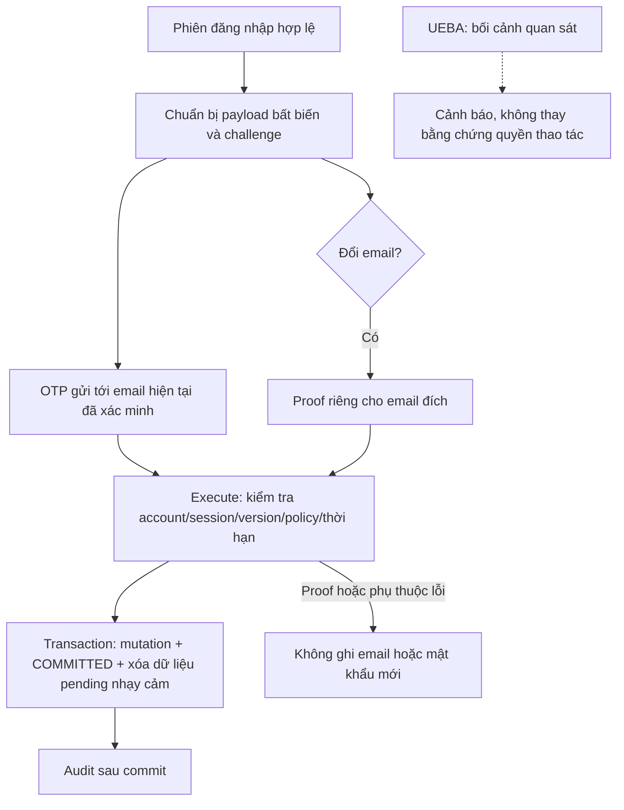

# Vận hành và phục hồi OTP trong local lab

Phạm vi: EMAIL_CHANGE/PASSWORD_CHANGE trên tài khoản local được khai báo bằng **ID phía server**. Email là kênh xác nhận trong giả định mailbox chưa bị chiếm; đây không phải MFA hoặc bảo đảm phát hiện người chiếm quyền. Model chưa qualify không được tắt OTP hoặc tự buộc tội người dùng.



## Điều kiện bật

- Mặc định `app.sensitive-action-confirmation.enabled=false`.
- Chỉ bật sau gate lab và kiểm thử SMTP thật. Allowlist phải có ID cụ thể, không dùng `*`, username hoặc email thay ID.
- Gate lab được chốt trong `lab-action-gate-protocol-v1`: từ chối nhầm <0,1%, ngăn thao tác thiếu proof hợp lệ >99%, CI một phía 95%, riêng cho mỗi loại thao tác. Mẫu lab không chứng minh tỷ lệ lỗi người dùng thực.
- Kiểm tra sau gate dùng `accept-local-otp-allowlist.py`: đọc receipt PASS trước khi khởi động Spring với policy từ runtime environment. Mail của lượt acceptance được giả lập; không gửi thêm thư ngoài.
- Không bật toàn bộ tài khoản hoặc AWS. Việc đưa một tài khoản có sẵn vào allowlist cần chọn đúng account ID và có provenance xác minh email hiện tại. Không backfill `email_verified_at` bằng một timestamp tự đặt.

## Cấu hình ứng dụng

Các property Spring đang được dùng:

```properties
app.sensitive-action-confirmation.enabled=true
app.sensitive-action-confirmation.account-allowlist=ID_TAI_KHOAN_LOCAL_DA_CHON
```

Đặt chúng trong cấu hình khởi động riêng của local lab. Không sửa mặc định cho mọi môi trường. ID trong các test là fixture dùng một lần, không tự coi là account của hệ thống đang vận hành.

Với stack Compose hiện hữu, thêm `-f docker-compose.otp-local.yml` sau
`-f docker-compose.yml` (Docker Compose >=2.24.4). File này truyền hai biến
`APP_SENSITIVE_ACTION_CONFIRMATION_ENABLED` và
`APP_SENSITIVE_ACTION_CONFIRMATION_ACCOUNT_ALLOWLIST` vào app, mặc định vẫn
`false`/rỗng. Website chỉ bind `127.0.0.1:8088`; có thể chọn cổng bằng
`OTP_LOCAL_HTTP_PORT`. Giữ nguyên project/volume của môi trường đã chọn;
không dùng `down -v` hoặc tự chuyển sang database rỗng.

Trước khi đặt `ENABLED=true`, xác định URL và account ID từ database local
đúng môi trường, kiểm tra nguồn xác minh email hiện tại, rồi khởi động lại
app với allowlist cụ thể. Đăng nhập bằng trình duyệt và kiểm tra policy
`required=true` cho tài khoản đó, `false` cho tài khoản ngoài danh sách.
Sau đó thử đổi email/mật khẩu qua form website, kiểm tra thiếu/sai proof
không ghi dữ liệu, proof đúng chỉ ghi một lần và đổi mật khẩu thu hồi phiên.
Các lượt gửi email và thay đổi tài khoản thật phải nằm trong phiên thử đã
thống nhất với chủ tài khoản; không dùng tài khoản fixture cũ làm thay thế.

### Website local lưu dữ liệu lâu dài

`observability/scripts/local-otp-site.py` quản lý project riêng
`flare-otp-local`, dùng lại stack MySQL/Redis/Spring/Nginx hiện hữu. Lệnh
`prepare` sao chép database từ `flare-local-elk-db-1` đang chạy sang volume
riêng và từ chối import lên database đích không rỗng. Bản gốc không bị migrate
hoặc thay tài khoản. Cấu hình mới sinh nằm trong runtime owner-private;
SMTP được nạp từ file của chủ máy, không sao chép vào cấu hình này.
Launcher kiểm tra lịch sử repeatable chỉ có seed E2E đã chạy, rồi dùng
`repeatable:missing` riêng trong bản sao local để giữ receipt seed cũ mà
không chạy lại seed ghi đè tài khoản sau mỗi lần khởi động. Schema migration
có version vẫn được validate; không chạy Flyway repair hoặc sửa lịch sử.

Các lệnh `build`, `start`, `status`, `stop` tương ứng build source hiện tại,
chạy website, xem trạng thái và dừng dịch vụ giữ volume. Chạy các bước hữu
hạn qua ledger như mục dưới. `enable` chỉ chấp nhận tài khoản local đã chọn
`e2e-customer` sau khi ứng dụng xác minh mailbox chủ máy và gate lab PASS;
không tự đặt timestamp xác minh. Website là `http://localhost:8088`.
Không áp dụng script này cho production hoặc database khác.

Tài khoản được chọn là `e2e_customer` / ID `e2e-customer` trong bản sao.
`bootstrap-account` là bước khởi tạo một lần từ hash fixture công khai, chỉ
chấp nhận tài khoản customer còn email giả chưa xác minh và policy đang tắt;
không dùng lại sau khi chủ máy xác minh email hoặc đổi mật khẩu.
Ngày 21/10/2026, email đã được chủ máy xác minh qua website và allowlist đã
bật. Receipt `activation-verification.private.json` kiểm HTTP thật: cả hai
endpoint mutation cũ trả 409/ACTION_CONFIRMATION_REQUIRED, trạng thái tài
khoản giữ nguyên. Không suy ra luồng thành công của deployment mới chỉ từ
các kiểm tra từ chối này.

`verify-local-otp-site.py` chỉ dành cho lần kiểm tra trước khi đổi mật khẩu
fixture; không chạy định kỳ sau khi người dùng đặt mật khẩu riêng.
`observe-local-otp-action.py` chờ tối đa 300 giây, chỉ đọc trạng thái DB,
không đọc mật khẩu mới/OTP. Hết thời gian chờ vẫn giữ website/volume;
receipt chờ không phải PASS của thao tác. Người dùng phải tự nhập mật khẩu
mới và OTP trên form website.

Sau kiểm thử trên website ngày 21/10/2026, có đúng một PASSWORD_CHANGE và
một EMAIL_CHANGE COMMITTED cho tài khoản này; cả hai pending đã scrub.
Email hiện tại là `qvo1312+flare-rollout@gmail.com`, đã được xác minh bằng
hai proof của luồng đổi email. Mật khẩu mới do chủ máy tự đặt, không lưu
trong tài liệu hoặc các script. Đã kiểm tra dừng/khởi động lại cả
app/nginx/MySQL/Redis: digest tài khoản và các action giữ nguyên, dịch vụ
healthy. Đây là restart có trật tự, không phải bằng chứng chống mất điện.
Các receipt nằm trong runtime `local-otp-rollout-20261020-r1`.

SMTP thật được đọc từ file owner-private do người dùng cung cấp, chỉ gồm APP_MAIL_USERNAME, APP_MAIL_PASSWORD, APP_MAIL_FROM và host/port Gmail đã chốt. Không shell-source file, không đưa password vào argv/log, không copy file này vào snapshot. `postlogin_mail_config.py` từ chối symlink, quyền chia sẻ, key ngoài allowlist, key trùng và nội dung shell expansion.

Tắt policy bằng `app.sensitive-action-confirmation.enabled=false` và khởi động lại local app. Không cần xóa migration, bảng hoặc dữ liệu. Đây là thao tác vận hành chủ động; không tự tắt policy vì Redis, SMTP hoặc worker lỗi.

## Chạy và đọc kết quả

Root evidence hiện tại: `/home/quan/PBL4(UpdateFromPBL3)/observability/runtime/postlogin-risk-context-20261020-r1`.

1. Đọc `operator-state.private.json`, `budget.private.json` và commit/receipt được trỏ tới; kiểm actual process/container trước khi làm mới một job.
2. Chạy job qua `postlogin_research_step.py`, giữ một writer, input hashes và ledger tích lũy. Command thực tế nằm trong trường `binding.argv` của từng receipt. Không chạy lại email smoke đã hoàn tất chỉ để lặp PASS.
3. Reuse cùng unit chỉ khi command và inputs giữ nguyên. Một unit đã commit không được ghi đè; input đổi phải có identity/unit mới và vẫn chịu budget chung.
4. Lượt trial dài ghi snapshot kết quả mỗi 20 thao tác. `PARTIAL_NOT_GATE_PASS` không phải nghiệm thu. Chỉ audit sau khi process terminal, receipt COMMAND_PASS, đủ counts và hashes hợp lệ.
5. Các endpoint thật nằm tại `/api/profile/action-confirmations` và `/{id}/execute`. Khi policy bật, gọi trực tiếp mutation cũ trả ACTION_CONFIRMATION_REQUIRED. Cập nhật tên/điện thoại không đổi email vẫn đi theo hành vi cũ.

Không đọc hoặc gửi OTP trong chat. Các trang human smoke chỉ bind localhost và chỉ gửi tới mailbox lab/alias đã chốt. Chúng dừng sau cửa sổ thử, không phải dịch vụ production thường trực.

## Sau lỗi hoặc mất kết nối

| Tình huống | Cách xử lý |
|---|---|
| Sai OTP | Thử lại cùng challenge trong thời hạn và giới hạn 5 lần; không tạo challenge mới để reset số lần sai. |
| Hết hạn/contact/authVersion/policy thay đổi | Yêu cầu cũ mất hiệu lực; tạo yêu cầu mới sau cooldown/rate limit. |
| SMTP không gửi được | Không mutation; pending không dùng được sẽ được dọn. Không suy ra thư đã tới chỉ từ việc đã gọi sender. |
| Redis lỗi trước khi tiêu thụ proof | Không mutation; có thể thử lại proof còn hạn khi dịch vụ hồi phục. |
| Proof đã tiêu thụ, DB rollback | Không khôi phục proof cũ hoặc tự tiếp tục mutation; cần mã/yêu cầu mới. Session revocation có thể đã xảy ra, cần đăng nhập lại. |
| Mất response sau commit | Không tạo mutation mới mù quáng. Cùng account/session/action ID được xử lý idempotent; đổi mật khẩu có thể đã thu hồi phiên cũ nên cần đăng nhập và kiểm tra trạng thái tài khoản. |
| Worker/telemetry lỗi | Ghi nhận lỗi bối cảnh riêng; không bỏ qua OTP. |
| App/research job bị kill | Giữ receipts và pending bytes; không xóa lock để ép chạy writer thứ hai. Nếu PID còn sống hoặc chưa qua deadline độc lập, tiếp tục quan sát. Unit chưa commit có thể phải chạy lại và vẫn bị tính budget. |

Pending hết hạn được scrub, sau đó dữ liệu cũ được purge theo retention 24 giờ. Không xóa evidence nghiên cứu hoặc database có dữ liệu người dùng để lấy chỗ. Model chỉ được chuyển sang serving sau các gate riêng; vòng hiện tại dừng STOP_NO_IMPROVEMENT nên không có holdout, adoption hoặc shadow mới.
